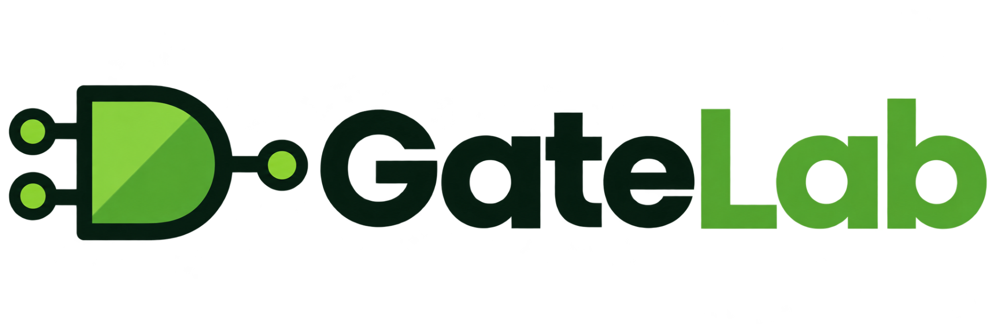

# GateLab

**A digital logic simulator for the classroom.**

GateLab is a free, open-source tool for introducing students to digital logic and the building blocks of computers. Students can experiment with switches, logic gates, outputs, and binary numbers on a visual canvas—then combine smaller circuits into reusable integrated circuits.

## What is GateLab?

GateLab helps beginners investigate **Boolean logic**, the logic gates that implement it, and how simple components can form increasingly sophisticated systems. Students can build and test circuits without purchasing physical electronics or learning a hardware-description language.

The interface includes input switches and multi-bit inputs, logic gates, light bulbs and numeric outputs, connections that show signal states, truth tables, and a way to save and reuse circuits as **integrated circuits (ICs)**.


## How to install

The simplest classroom setup uses **Docker**, which runs GateLab as a self-contained web application. Your students then visit the server's address in their browsers; nothing needs to be installed on their devices.

You'll need a computer or server with Docker installed, a network connection, and an available port. **Portainer** is optional, but recommended if you prefer a graphical interface instead of terminal commands.

### Option A — Install with Portainer (recommended)

1. Open Portainer and choose the Docker environment where you want to run GateLab.
2. Go to **Stacks → Add stack**, name it `gatelab`, and select the **Web editor**.
3. Paste this configuration:

```yaml
services:
  gatelab:
    image: ghcr.io/shields10-cal/gate-lab:latest
    pull_policy: always
    container_name: gatelab
    restart: unless-stopped
    ports:
      - "8088:80"
    healthcheck:
      test: ["CMD-SHELL", "wget -q -O /dev/null http://127.0.0.1/healthz || exit 1"]
      interval: 30s
      timeout: 3s
      retries: 3
      start_period: 10s
```

4. Click **Deploy the stack**. Portainer will download the container image and start GateLab.
5. Open `http://YOUR_SERVER_IP:8088` from a browser on the same network. Replace `YOUR_SERVER_IP` with your Docker server's address. When running Docker locally, try `http://localhost:8088`.

If port 8088 is already in use, change the **first** number in `"8088:80"` to another available port.

**To update manually:** Open the GateLab stack in Portainer, choose **Editor → Update the stack**, and make sure Portainer re-pulls the image. Updates to GitHub do not automatically redeploy your classroom container.

### Option B — Install with Docker commands

If Docker is installed and you prefer a terminal, run:

```bash
docker run -d --name gatelab --restart unless-stopped -p 8088:80 ghcr.io/shields10-cal/gate-lab:latest
```

Then visit `http://localhost:8088` (or your server's IP and port 8088 from another computer).

GateLab does not require a database or student accounts. Projects are stored in the browser and can be imported/exported as files. Encourage students to export important projects, especially when using shared computers or browsers that clear their data.

## How to use

Start by placing **two toggle switches**, an **AND gate**, and a **0/1 output** onto the canvas. Connect the switches to the gate's two inputs, then connect the gate's output to the display. Toggle each switch and observe when the output becomes 1. Try replacing the AND gate with OR, NOT, NAND, or NOR, and compare the results with their truth tables.

Students can move beyond individual gates by building more complex circuits, labeling inputs and outputs, and saving a selection as a **custom integrated circuit**. Creating an IC turns a complete working circuit into a reusable component with named pins. This is GateLab's defining instructional feature: students can use something complex without having to rebuild—or see—all of its internal details.


### Teaching abstraction: toward a ripple-carry adder

The central instructional goal is to help students understand **abstraction**: treating a collection of simpler parts as one higher-level component.

One possible learning progression is **logic gates → XOR → half adder → full adder → 4-bit ripple-carry adder**. At each stage, students test the circuit, turn it into an IC, and use that IC to construct the next stage. By the end, they can demonstrate how binary addition emerges from simple Boolean operations.


GateLab is an open-ended simulator rather than a fixed lesson sequence. Teachers can set their own challenges, ask students to predict circuit outputs, collect truth tables, and have students explain what is hidden inside each level of abstraction.

## Credits

**GateLab was created by Tobin Shields** for introductory computer science and digital logic instruction.

The project was inspired by several online logic circuit simulators and classroom tools. Its focus on approachable interactions, clear visual signals, and reusable integrated circuits reflects the needs of an introductory classroom. GateLab is an independent project and is not affiliated with or endorsed by those other simulators.

GateLab is distributed under the [MIT License](LICENSE).

## Development transparency and security

**GateLab was developed with the assistance of ChatGPT.** Tobin Shields directed its instructional design, functionality, testing, and iterative revisions, using AI-generated code as part of development. This disclosure is included so teachers and developers can make informed decisions about adopting the software.

**Security warning:** GateLab has not undergone a comprehensive independent security audit. Its code should **be assumed to contain vulnerabilities**, and it is **not suitable for unrestricted public, internet-facing deployment**. Deploy only in appropriately protected, trusted educational environments, with network restrictions and access controls suitable for your school. Do not rely on it to store or protect sensitive student information.

GateLab was developed through repeated refinement with an emphasis on clarity, ease of use, and classroom practicality. Its features and interactions were informed by teaching introductory computing and using student feedback. **Classroom review and usability testing are not evidence of security**, and they do not guarantee the software is free of defects.
